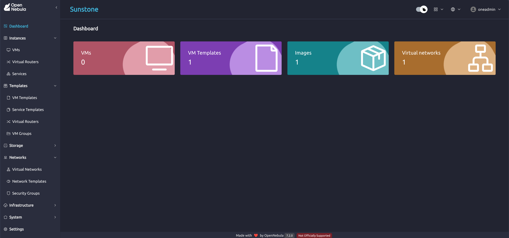
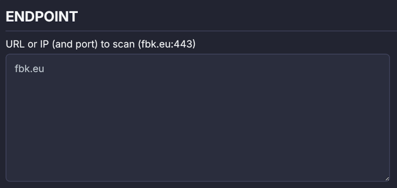
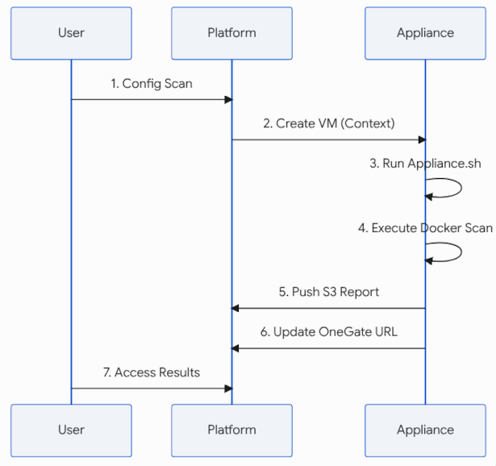
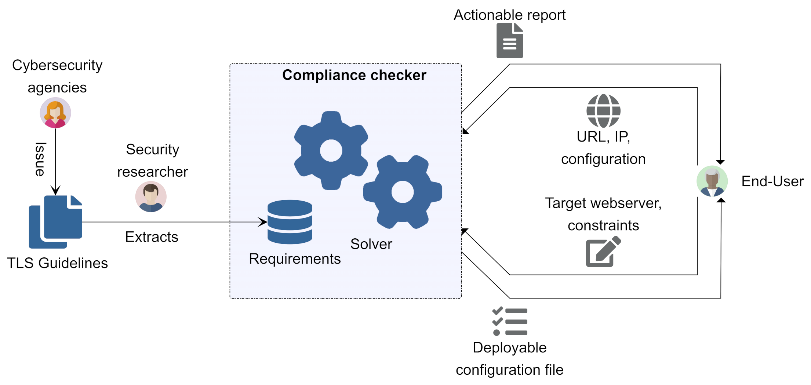

# Abstract

Cloud management platforms such as [OpenNebula](https://opennebula.io/) are essential for modern cloud infrastructures because they simplify the orchestration, deployment, and lifecycle management of complex services across multi-cloud and edge infrastructures. However, this may come with a downside: if the security does not come with the same degree of facilitation, end-users will experience its integration as more burdensome than it was on in-house deployments. This discrepancy has the unfavorable potential of broadening the gap between a quick deployment and a secure one, risking the launch of compromised services with escalating security consequences.
To fill this gap, we decided to integrate TLSAssistant as an OpenNebula appliance. By delivering an automated TLS analysis and compliance engine via a standardized cloud appliance service, we remove deployment friction without compromising security posture.  However, integrating an isolated tool into a distributed cloud environment extends beyond wrapping it in a container; it requires a shift in its architectural paradigm. We needed to re-evaluate TLSAssistant's operational model within an environment dominated by long-lived (micro)services that spend most of their lifecycle idle, waiting for requests.  Moreover, prior to our contribution, neither the OpenNebula nor the [Virt8ra](https://opennebula.io/initiatives/virt8ra/) ecosystem had formally accommodated ephemeral, on-demand appliances, making this integration a pioneering effort in its field.
Beyond solving an engineering challenge, this work significantly enhances the developer experience. By streamlining access to advanced TLS analysis, this integration eliminates usability friction, accelerating the adoption of critical security and compliance tooling across cloud platforms. 



Today more than ever, digital sovereignty is a topic in European policy discussions. The EU and its Member States share the goal of strengthening its competitiveness and strategic autonomy, supporting Europe’s transition to a sovereign and secure cloud ecosystem.
The [IPCEI-CIS](https://competition-policy.ec.europa.eu/state-aid/ipcei/approved-ipceis/cloud_en) (Important Projects of Common European Interest - Next Generation Cloud Infrastructure and Services) is the first IPCEI in the cloud and edge computing domain. It aims to develop an interoperable, openly accessible European data processing ecosystem across a multi-provider cloud-to-edge continuum. In the context of the IPCEI-CIS, [OpenNebula](https://opennebula.io/), which leads the IPCEI-CIS [Virt8ra cluster](https://opennebula.io/initiatives/virt8ra/), is an open-source cloud management platform for orchestrating cloud and edge computing infrastructure resources. A key mechanism in OpenNebula is the use of **Appliances**: pre-configured virtual machine (VM) images or service templates packaged for single-click deployment and automated orchestration via the OpenNebula Marketplace. Common examples of appliances include pre-configured web servers (e.g., Nginx, Apache), database systems (e.g., PostgreSQL or MySQL) and content management systems (e.g., WordPress).

To support security analysis, the [Center for Cybersecurity](https://cs.fbk.eu/) at [Fondazione Bruno Kessler](https://www.fbk.eu/en/), developed [TLSAssistant](https://github.com/stfbk/tlsassistant/). TLSAssistant is an open-source modular framework capable of identifying a wide range of TLS vulnerabilities and assessing compliance with multiple guidelines.
TLSAssistant was originally architected outside the IPCEI-CIS framework as an autonomous standalone tool designed to run locally on a host machine or inside Docker containers.
Following its development, we decided to integrate TLSAssistant into the IPCEI-CIS ecosystem by packaging it as a ready-to-use OpenNebula Appliance.

## Building a Barebone OpenNebula Appliance

While the conceptual transition from a Docker container to an OpenNebula Appliance is straightforward, since it simply involves configuring a VM to execute the container on startup, the practical execution required some effort. Navigating the initial documentation[^1] and refining the provided scripts required considerable effort, primarily due to the official guides being outdated during the development phase (at the time of writing the documentation has been fixed and is now clearer).
After creating a dedicated VM and spending some time building non-documented dependencies, we utilized the provided appliance generation script[^2] to construct a minimal appliance that would simply execute the TLSAssistant image on instantiation. However, this initial version failed to operate since TLSAssistant requires specific runtime parameters, such as target hostnames and scan profiles, to execute.
Therefore, the boot process had to be updated using OpenNebula contextualization to dynamically pass the required configuration flags at startup via [Sunstone](https://docs.opennebula.io/7.4/product/control_plane_configuration/graphical_user_interface/fireedge_sunstone/), the OpenNebula Web UI shown in Figure 1, allowing the appliance to initialize and execute scans as intended.

<figure>
  
  <figcaption>Figure 1: Sunstone UI Main Dashboard</figcaption>
</figure>

## Deploying OpenNebula Locally

To evaluate the basic generated appliance and start refining its operational lifecycle, we deployed a local cloud testing environment on the dedicated VM. Rather than manually configuring individual infrastructure services, we used [MiniONE](https://github.com/OpenNebula/minione), OpenNebula’s official automated deployment utility. MiniONE streamlined the setup process by configuring a complete, self-contained OpenNebula evaluation stack, with the OpenNebula Frontend, a KVM hypervisor node, and the necessary virtual networking bridges.

## Working with Contextualization

Contextualization in OpenNebula serves as a critical method for seeding configuration metadata into a VM during its initialization phase, and it is achieved by mounting a virtual CD-ROM. The underlying workflow is simple: the web interface transmits the selected parameters as a key-value dictionary via a PUT request to the instantiation API endpoint. Subsequently, the backend generates a context.sh shell script; this file is then sourced during the boot sequence, effectively exporting the configuration into the appliance's environment variables. These context variables can then be used in the appliance.sh file (the main installation script which is sourced by the one-apps service manager[^3] at build and boot time), where we sanitize them, replace them with defaults if invalid or unset (e.g., substituting “all” in ONEAPP_SCAN_VULN_MODULES with the full list of default vulnerability modules, or trimming trailing slashes from S3 endpoints), and use them to configure the scan to the user's requirements.

The local deployment provided access to the Sunstone web interface for direct management and monitoring of VM instances. Using Sunstone, custom contextualization variables (such as target’s hostname), defined inside the initial **VM template**[^4], could be seeded at instantiation time.

An entry in the VM template, which renders as shown in Figure 2, looks like this:

`VARIABLE_NAME = Mandatory/Optional | INPUT_TYPE | DESCRIPTION | OPTIONS* | DEFAULT`

As an example: `TARGET_URL = "M|text|URL or IP (and port) to scan||fbk.eu”`

\* some input types require options (notably list-multiple which is described later)

<figure>
  
  <figcaption>Figure 2: View of the TARGET_URL Template Entry in the Sunstone UI</figcaption>
</figure>

## Retrieving Reports

Once the VM initializes, it triggers the containerized scan using the supplied contextualization variables to configure execution flags. Upon completion, the container generates a PDF report which would then be stored in a mounted volume on the appliance’s filesystem. We therefore needed to find a way to deliver this report to the end-user. Since users lack direct filesystem access to the appliance and relying on SSH for manual retrieval would result in poor user experience, a more integrated delivery mechanism was required.

We evaluated several architectural patterns for report retrieval, including:
- **Native Persistent Datablocks**: The appliance mounts a persistent storage block, writes the report, and detaches. While feasible, this provides a poor UX as the user must manually manage disks and secondary VMs to view files.
- **Object Storage via OneGate**: The results are pushed to an S3-compatible bucket, after which the appliance uses [OneGate](https://docs.opennebula.io/7.4/product/operation_references/opennebula_services_configuration/onegate/) to update its USER_TEMPLATE with a pre-signed URL.
- **Shared Network Filesystem**: Reports are written to a centralized webserver via a shared network. Similar to the S3 approach, this uses OneGate for metadata transmission but relies either on a private web server for hosting or external hosting infrastructure.

Seeking an architecture decision, FBK and OpenNebula technical teams jointly established a preferred pattern: considering the S3 endpoint as the standard output interface. In this model (see Figure 3), the TLSAssistant template should support S3 credentials as context variables (Step 1), upload the reports (Step 5), and serve the access link to the user via OneGate (Step 6).
This pattern is what they would consider being the **standardized way** to handle ephemeral appliance outputs today. Moreover, considering an environment where the appliance has to be ready-to-run, DNS and networking cannot be delegated to the end user. For this reason, we introduced an S3_CUSTOM_HOST_IP parameter which can be used to programmatically seed the appliance’s hosts file, effectively mitigating Split-DNS[^5] issues.

In the final workflow, the appliance script captures the generated report, uploads it to the configured S3 storage, and generates both pre-signed and standard URLs. These links are then pushed back to the user via OneGate, providing flexibility for various client-side storage configurations while allowing for signature customization through additional context variables.

<figure>
  
  <figcaption>Figure 3: Execution Sequence Schema</figcaption>
</figure>

## Integrating Compliance Analysis

Since TLSAssistant’s version 3.0[^6], the framework has featured a specialized module for auditing compliance against diverse security guidelines.

<figure>
  
  <figcaption>Figure 4: Compliance Module Architecture Schema</figcaption>
</figure>

While adding support for most of the compliance-related flags was trivial as it had been with the previously supported features, certain advanced features required the usage of specialized inputs. Specifically, to enable tailored compliance scans, the appliance must allow users to provide their own custom guidelines, requiring a mechanism to inject these files from the user’s local machine into the appliance to then mount them into the container.
Recognizing the non-trivial nature of this implementation, we consulted with OpenNebula, who pointed us toward an existing file injection capability that we had completely overlooked. Because the platform cannot programmatically enforce the correctness of these injections, this responsibility remains with the user, supported primarily by the appliance’s documentation[^7] and sanitization at runtime.

## Finding and Fixing Serialization Issues

With the appliance operational, we prioritized enhancing the user experience by implementing **list-multiple** input types for various configuration parameters. This allowed for more granular control, such as selecting specific vulnerability modules instead of running the entire suite, or utilizing TLSAssistant’s compare_many module to audit multiple compliance guidelines simultaneously. However, integrating these multi-select inputs exposed a significant serialization bug within the Sunstone UI. The backend’s XML-RPC core parser expects a single string for these parameters; however, the frontend was attempting to submit these selections as native JavaScript arrays. Consequently, the HTTP request serialized these arrays as repeated, duplicate keys. During backend processing, the parser encountered these duplicate keys and sequentially overwrote the parameters, meaning only the final selected value persisted (e.g., a selection of "A", "B", "C" would be truncated to just "C").
To address this, we submitted the pull request `#7742`[^8]. The fix involves intercepting the form state and transforming the selected array into a comma-separated string, ensuring the data aligns with the backend's expectations. While this resolves the current incompatibility, it is worth noting that this is a patch for the UI to match existing backend parsing; a future, more robust solution might involve standardizing this data type natively across the core API or rewriting the backend to correctly parse arrays. Our pull request was merged in versions 7.4.1 and 7.6 of OpenNebula’s **one platform**.

## Conclusions

Prior to our contribution, neither the OpenNebula nor the Virt8ra ecosystem had formally accommodated ephemeral, on-demand appliances, making this integration a pioneering effort in its field. Transitioning from an autonomous tool to a cloud-based solution requires new paradigms, standardization, and significant effort. By introducing a use case for these short-lived, task-specific appliances and defining a dependable model for report distribution via automated S3 uploads, we believe our work helps lay a solid framework for future standardization.

## References
[^1]: [https://github.com/OpenNebula/marketplace-community/blob/master/docs/AUTOMATIC_APPLIANCE_GUIDE.md](https://github.com/OpenNebula/marketplace-community/blob/master/docs/AUTOMATIC_APPLIANCE_GUIDE.md)
[^2]: [https://github.com/OpenNebula/marketplace-community/blob/master/docs/automatic-appliance-tutorial/generate-docker-appliance.sh](https://github.com/OpenNebula/marketplace-community/blob/master/docs/automatic-appliance-tutorial/generate-docker-appliance.sh)
[^3]: [https://github.com/OpenNebula/one-apps](https://github.com/OpenNebula/one-apps)
[^4]: [https://docs.opennebula.io/7.4/product/operation_references/configuration_references/template/](https://docs.opennebula.io/7.4/product/operation_references/configuration_references/template/)
[^5]: [https://en.wikipedia.org/wiki/Split-horizon_DNS](https://en.wikipedia.org/wiki/Split-horizon_DNS)
[^6]: [https://github.com/stfbk/tlsassistant/releases/tag/v3.0.0](https://github.com/stfbk/tlsassistant/releases/tag/v3.0.0)
[^7]: [https://github.com/stfbk/tlsassistant-one/blob/master/README.md](https://github.com/stfbk/tlsassistant-one/blob/master/README.md)
[^8]: [https://github.com/OpenNebula/one/pull/7742](https://github.com/OpenNebula/one/pull/7742)
